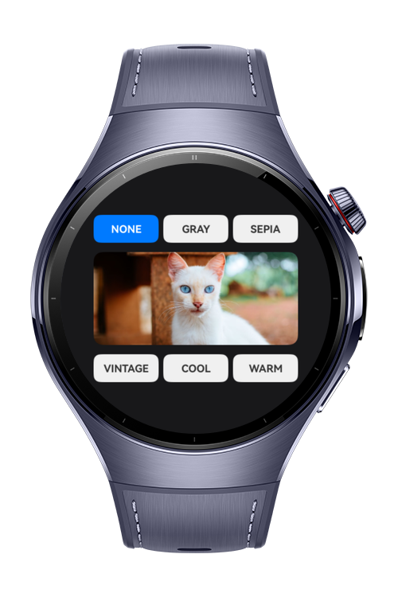
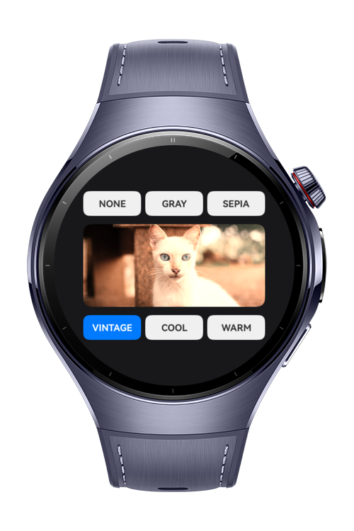
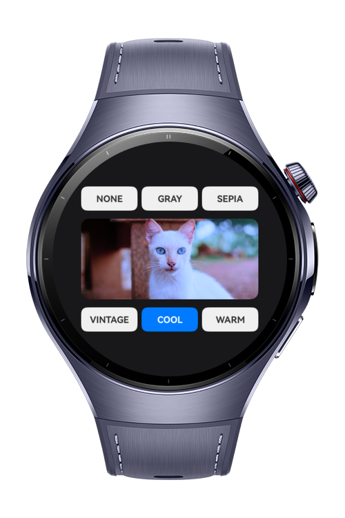
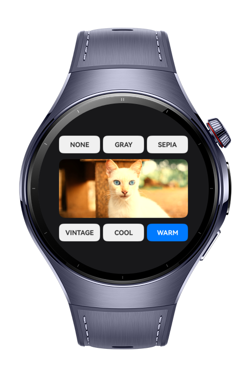

> **Note:** To access all shared projects, get information about environment setup, and view other guides, please visit [Explore-In-HMOS Index](https://github.com/Explore-In-HMOS/hmos-index).

# How to use Image Effects

ImageEffect is designed for HarmonyOS Next wearable devices, allowing users to quickly apply creative image effects to
photos. The app provides a simple interface to experiment with popular image filters such as sepia, grayscale, and other
color adjustments.

# Preview

<p align="left">
  
  
  
  
</p>

# Use Cases

Perfect for quickly experimenting with visual effects and enhancing images on wearable devices. Ideal for trying out
creative filters, color adjustments, and artistic transformations.

# Tech Stack

- **Languages**: ArkTS, Typescript
- **Frameworks**: HarmonyOS SDK 5.1.0(18)
- **Tools**: DevEco Studio Vers 5.1.0.842
- **Libraries**: @kit.ArkUI, @kit.ImageKit

# Directory Structure

```
entry/src/main/ets/
├───entryability
│       EntryAbility.ets
├───entrybackupability
│       EntryBackupAbility.ets
├───lib
│   ├───ColorFilters.ets
├───pages
│       Index.ets
└───
```

# Constraints and Restrictions

## Supported Devices

- Huawei Watch 5

# LICENSE

Image Effect is distributed under the terms of the MIT License.
See the [LICENSE](/LICENSE) for more information.